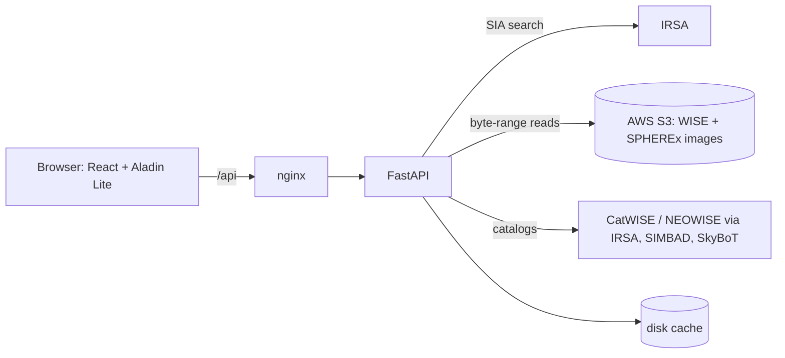

# Ultracool Browser

**Watch 16 years of the infrared sky move.** Pick any star, brown dwarf or patch of sky and play NASA infrared images from WISE (2010), NEOWISE (2014–2024) and SPHEREx (2025–2026) as one aligned flipbook. The app measures motion, colour, brightness changes and a 0.75–5 µm SPHEREx spectrum typed against brown-dwarf templates.

Built for NASA Space Apps 2026 ("Planet X and SPHEREx").

## Four modes

| Mode | For | What you get |
|---|---|---|
| **Learn** | newcomers | Seven short lessons on real data, each with a quiz: something moves (Barnard's Star), right colour (WISE 0855−0714), move together (ε Indi A + B), brightness changes (AL Bootis), no pattern (RW Aurigae), real or ghost (an optical ghost of ε Indi A), asteroid ((888) Parysatis). |
| **Explore** | curious minds | Search any name or coordinates; a "What we found" panel answers in plain English: does it move, is it cold, does it change, what type is it. Drag the cyan probe onto any other source in the field to measure it too. |
| **Research** | astronomers, students | Proper motion fitted from our own images with errors, W1−W2 colour, variability (χ², Lomb–Scargle with cadence-alias warnings), SPHEREx spectral typing, catalog overlays, blink and difference images, deep stacks, single exposures, probe measurements of any source, CSV export with provenance. |
| **Discover** | citizen scientists | Scan a 0.25° field for every moving source, vetted against image artifacts and CatWISE; classify candidates as real mover, artifact or unsure and export your classifications. |

## Science result

Using this pipeline, **WISE J231728.42−665959.3 was typed for the first time: a T5–T6 brown dwarf at ~28 pc**, co-distant with the star pair HD 219509/219495 but not moving with it. Details, the candidate table and the methods are in [`research/`](research/README.md).

## Quick start

Requires Docker with Compose and outbound HTTPS to IRSA (`irsa.ipac.caltech.edu`), AWS S3 and SIMBAD.

```bash
cp .env.example .env            # set PUBLIC_HOSTNAME / PUBLIC_PORT
docker compose up --build -d
open http://localhost:8080      # first view of a new field takes 1-3 min, then it is cached
```

Pre-compute the demo targets and lesson fields (optional, ~20 min):

```bash
docker compose exec api python -m scripts.prewarm
```

Pre-compute many objects, e.g. every T and Y dwarf in the SPIFF catalog (resumable; scales with CPU cores):

```bash
docker compose exec api python -m scripts.batch --spt-min T0 --spt-max Y1 --movers --state /data/cache/batch_TY.jsonl
```

## How it works



- **Frames:** WISE/NEOWISE L1b exposures and SPHEREx L2 images are read directly from the public NASA S3 buckets (only the needed pixels), masked with the missions' artifact flags, and resampled onto one 2.75″ grid. WISE exposures of each visit are combined with a sigma-clipped mean.
- **Photometry:** SPHEREx on native pixels with the pipeline variance, PSF aperture correction and crowded-field sky estimate; WISE with an aperture correction calibrated on CatWISE stars. Saturated stars fall back to NEOWISE/AllWISE catalog photometry.
- **Motion:** centroids along the predicted track in 2-year WISE stacks and SPHEREx epochs, weighted linear fit; "moving" needs ≥3σ over ≥2 years and ≥3 epochs.
- **Spectra:** SPHEREx fluxes binned into the 102 SPIFF channels and fitted with 47 SPIFF templates (M8–Y1); a type is only given when the source is detected at S/N ≥ 5 at 3.5–5 µm. Matches are demoted ("warmer than M8: probably an ordinary star" or "doubtful") when the 1.4 µm water band is too shallow for the template or W1−W2 is bluer than the Schmidt et al. 2015 locus; spectra polluted by neighbours or with many negative channels are flagged.
- **Colour classes:** W1−W2 cuts at 0.6 / 1.6 / 2.6 mag from the Kirkpatrick et al. 2021 colour–type relation (T0 ≈ 0.63, T5 ≈ 1.57, T8 ≈ 2.62).
- **Movers (Discover):** our own detection, not a catalogue lookup. Sources are found in 2-year W2 deep stacks and linked into straight-line tracks; a track must be detected in ≥ 4 windows (≥ 60%), fit a line (χ²ᵣ ≤ 3), move ≥ 5σ and ≥ ~0.7″/yr, empty its old position, not sit on a static source, and not coincide with WISE's own spike/halo/ghost artifact tables around bright stars. CatWISE/SIMBAD/SPIFF only label a mover "known" when position *and* motion agree. Limits: W2 only (≈ W2 < 16.5), slower movers not reported, only the opened field is searched.
- **Probe:** any point in a field can be measured: a ~2 s preview from the cached images (calibrated aperture correction, inflated errors), or a full re-measurement on the original SPHEREx pixels with the target method.

A plain-language guide for non-astronomers is in [`docs/GUIDE.md`](docs/GUIDE.md).

## Configuration

| Variable | Default | Meaning |
|---|---|---|
| `PUBLIC_HOSTNAME`, `PUBLIC_PORT` | `localhost`, `8080` | nginx server name and published port |
| `CACHE_DIR` | `/data/cache` | frame/result cache (a Docker volume) |
| `WORKER_PROCESSES` | CPU count | frame-processing processes |
| `S3_MAX_CONCURRENCY` | 8 × workers | parallel S3 reads |
| `IRSA_MAX_CONCURRENCY` | `2` | parallel IRSA requests (IRSA throttles above ~2) |
| `MAX_RUNNING_SEQUENCES` | max(4, workers) | fields fetched at once; others wait in line (`queue_position`, `eta_s`) |

nginx limits each visitor to ~12 new fields and ~4 full probe measurements per minute (with bursts); everything else is unlimited, and requests from the host itself are exempt (`frontend/nginx.conf.template`).

## API

| Endpoint | Purpose |
|---|---|
| `GET /api/resolve?q=` | name, designation or coordinates → position and proper motion |
| `POST /api/sequences` | start/reuse an aligned frame sequence (`ra, dec, pmra_masyr, pmdec_masyr, epoch_yr, fov_deg, mjd_min, mjd_max, wise_exposures`) |
| `GET /api/sequences/{id}` | manifest: status, `queue_position`, `eta_s`, grid WCS, frames with photometry |
| `GET /api/sequences/{id}/summary` | motion, colour, variability, spectrum, asteroids, plain-English sentences |
| `GET /api/sequences/{id}/movers` | moving sources in the field, vetted against static sources, bright-star artifacts and CatWISE |
| `GET /api/sequences/{id}/probe?ra&dec[&mode=full]` | measure any point in the field: quick preview from cached images, or a full re-measurement on the original pixels |
| `GET /api/sequences/{id}/spectrum`, `/catalog_lightcurve`, `/export.csv` | spectral typing, catalog light curve, photometry export |
| `GET /api/sequences/{id}/stack.png`, `/diff.png`, `/frames/{frame}.png` | deep stacks, difference images, frames |
| `GET /api/ucds`, `/api/ucds/near` | SPIFF ultracool-dwarf catalog search |

## Development

```bash
cd backend && pip install -r requirements.txt && pytest -q tests
CACHE_DIR=/tmp/cache uvicorn app.main:app --port 8000
cd frontend && npm ci && npm run dev      # proxies /api to localhost:8000 (VITE_API_TARGET to change)
```

## Data and credits

WISE (Wright et al. 2010) and NEOWISE (Mainzer et al. 2011, 2014) images and catalogs, SPHEREx (Doré et al. 2014) Level-2 images, CatWISE2020 (Marocco et al. 2021): NASA/IPAC Infrared Science Archive. SIMBAD (CDS, Harvard mirror). Asteroids: IMCCE SkyBoT. Brown-dwarf templates and catalog: SPIFF (Gagné et al. 2026, doi:10.5281/zenodo.19051216, CC-BY 4.0; see `backend/app/data/ATTRIBUTION.md`). Sky viewer: Aladin Lite (CDS). Software: Astropy, photutils, reproject, FastAPI, React, Plotly.
