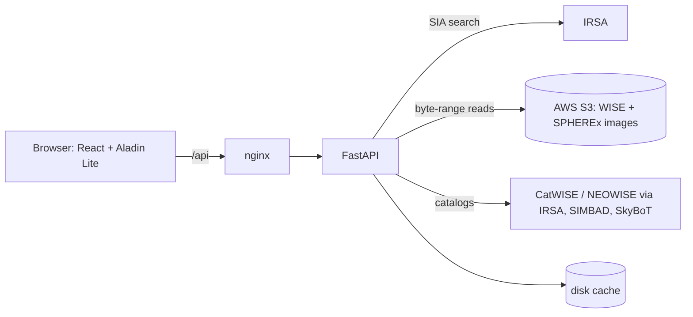

# How it works

This page follows one field through the pipeline, from the archive query to the answers shown in Explore. For each step we name the published method or tool it comes from. How well each step works is measured in [validation.md](validation.md).

## Data access

A name is resolved with SIMBAD, which also gives the proper motion we use to predict where the object should be on each date. We then ask the IRSA Simple Image Access service for every WISE, NEOWISE and SPHEREx image that covers the position. The images themselves are public in NASA's S3 buckets, so we read only the bytes of the small section we need instead of downloading whole files. IRSA throttles parallel requests, so archive queries run at most two at a time.

We use WISE and NEOWISE Level-1b single exposures in W1 (3.4 µm) and W2 (4.6 µm) (Wright et al. 2010; Mainzer et al. 2011, 2014) and SPHEREx Level-2 images from the DR1 and QR3 releases (Doré et al. 2014). Rows that are noise or auxiliary products are dropped.

## Alignment

Every image is resampled onto one tangent-plane grid with 2.75″ pixels, the native WISE pixel size, using the `reproject` package. That puts 16 years of images from two missions with different cameras on the same pixels, which is what makes the flipbook and the difference images work.

Pixels that the missions flag as bad are masked before anything is measured. For SPHEREx that is every bit in the `FLAGS` image except the informational `SOURCE` and `FULLSAMPLE` bits. For WISE we use IRSA's conservative L1b pixel mask (NEOWISE Explanatory Supplement III.3.d) without the saturation bits, and we also read the per-frame artifact tables that sit next to each image in the archive (diffraction spikes, halos, optical ghosts and latents; WISE Explanatory Supplement IV.4.g).

WISE exposures are grouped into visits by gaps of more than 10 days, the epoch rule of the unWISE time-resolved coadds (Meisner et al. 2018), and each visit is combined with a sigma-clipped mean. That removes cosmic rays and single-frame artifacts but also removes asteroids, so the asteroid lesson uses single exposures instead.

## Photometry

SPHEREx fluxes are measured on the native pixels, not on the resampled grid, with the pipeline's variance image and an aperture correction from the mission's own effective PSF (the `EPSF` extension in each file). The aperture radius is 12.3″. WISE fluxes are measured on the visit stacks in 8.25″ apertures with an aperture correction calibrated on CatWISE2020 stars (Marocco et al. 2021). Aperture sums and sigma-clipped sky annuli use `photutils`.

Very bright stars saturate both cameras. For those we fall back to the NEOWISE and AllWISE catalogue photometry and say so in the answer.

### Neighbour-aware PSF fitting

A SPHEREx pixel is about 6″ wide, so a star 10″ away can put a lot of light into the target's aperture. When catalogued neighbours put more than 10% of the target's light into its aperture in any band, we re-measure the spectrum by fitting the target and every CatWISE2020 source within 44″ together, frame by frame, with one Gaussian PSF and a constant sky. Positions are fixed at the catalogue positions moved to the frame's date. Neighbours closer than 5″ cannot be separated and are reported as blends instead of being fitted.

This is the same idea as the PSF-fit photometry that SPIFF (Gagné et al. 2026) and SPExPI (Kiwy 2026) use, with a simpler PSF so that it runs in a few seconds per field. The flux scale and error model were calibrated on isolated dwarfs and on empty sky; the numbers are in [validation.md](validation.md#neighbour-aware-psf-photometry).

## Motion fit

We centroid the object along its predicted track in 2-year WISE stacks and in each SPHEREx epoch, then fit a straight line in RA and Dec against time by weighted least squares. The app only says "moves" when the motion is at least 3σ over at least 2 years and 3 epochs. The idea of fitting a linear motion to epoch-grouped WISE detections is the one CatWISE uses (Eisenhardt et al. 2020; Marocco et al. 2021).

## Colour classes

W1−W2 is the classic brown-dwarf temperature indicator. Our colour classes are cut at 0.6, 1.6 and 2.6 mag, which is where the Kirkpatrick et al. (2021) colour–type relation reaches T0 (0.63), T5 (1.57) and T8 (2.62). To flag a doubtful spectral match we also compare the colour with the M8 and L-dwarf loci of Schmidt et al. (2015) and the M-dwarf colours of dal Ponte et al. (2023).

## Variability

Each band gets a χ² test against a constant brightness, with a 5% repeatability floor per visit, and a Lomb–Scargle periodogram (Astropy `LombScargle`) when there are at least 8 epochs. A period is reported only at a false-alarm probability below 1%. NEOWISE visits a field about every six months, so periods near 1/k years are cadence aliases; the app warns about them and lists the alternatives instead of picking one. "Irregular" means χ²ᵣ above about 3 with no significant period.

## SPHEREx spectral typing

The typing follows SPIFF (Gagné et al. 2026) and uses its published data release: 47 hybrid templates from M8 to Y1 and its table of 102 SPHEREx channels.

1. Frame fluxes are converted to F_λ and combined per channel with inverse-variance weights. Frames more than 5× their own error plus the channel's spread from the channel median are dropped, and with three or more frames the channel error is scaled up when the frames scatter more than their errors say.
2. Each template is scaled to the data analytically and scored by χ², with a 5% per-channel systematic floor.
3. The type range is every template within Δχ² = 4 of the best, widened by one subtype each way, because on our validation set the statistical range alone was too narrow (see [validation.md](validation.md)).

A type is only given when the source is detected at S/N ≥ 5 at 3.5–5 µm. Matches are demoted to "warmer than M8: probably an ordinary star" or "doubtful" when the 1.4 µm water band is too shallow for the template, a test based on how that band deepens along the M, L and T sequence (Reid et al. 2001; Cushing et al. 2005), or when W1−W2 is bluer than the template's type allows. Molecule bands (H₂O, CH₄, CO, CO₂, NH₃) are drawn on the plot as approximate guides.

## Movers search

Discover runs our own detection, not a catalogue lookup. Sources are found in 2-year W2 deep stacks at 4.5σ and linked into straight-line tracks, as in the unTimely approach of detecting per epoch and linking afterwards (Meisner et al. 2023). A track must:

- be detected in at least 4 windows and at least 60% of them;
- follow a straight line (χ²ᵣ ≤ 3) and move at 5σ or more;
- leave its old position empty and not sit on a static source;
- not coincide with WISE's own spike, halo and ghost tables around bright stars.

CatWISE, SIMBAD and SPIFF only label a mover "known" when both position and motion agree. The search is limited to W2 (about W2 < 16.5), to the opened field, and to motion above about 0.7″/yr, below which a mover cannot be told from a static source with this test. The flipbook with a human looking at it is the Backyard Worlds idea (Kuchner et al. 2017).

Known asteroids in each WISE visit are looked up with IMCCE SkyBoT (Berthier et al. 2006).

## Probe

Any point in a field can be measured. The quick mode takes about 2 s and uses the cached grid images with a calibrated aperture correction and inflated errors. The full mode goes back to the original SPHEREx pixels and runs the same method as for the target.

## What we built vs. what we use

We are IT students. The science in this tool comes from other people's data, papers and code, listed below. Our part is the integration and the checking.

From others:

- Images and catalogues: WISE, NEOWISE and SPHEREx images and the CatWISE2020 and AllWISE catalogues from the NASA/IPAC Infrared Science Archive; Gaia DR3; SIMBAD and VizieR (CDS); VHS photometry for some checks; the UltracoolSheet (Best et al., Zenodo 15802304) for literature types and colour loci.
- Templates and typing method: SPIFF (Gagné et al. 2026), including the 47 templates, the channel table and the 16,917-object ultracool-dwarf catalogue.
- Relations: the colour–type and type–absolute-magnitude relations of Kirkpatrick et al. (2021), the colour loci of Schmidt et al. (2015) and dal Ponte et al. (2023), and the water-band behaviour from Reid et al. (2001) and Cushing et al. (2005).
- Methods: epoch grouping from unWISE (Meisner et al. 2018), motion fitting as in CatWISE (Eisenhardt et al. 2020; Marocco et al. 2021), detect-and-link from unTimely (Meisner et al. 2023), the flipbook from Backyard Worlds (Kuchner et al. 2017), artifact geometry from the WISE Explanatory Supplement, asteroid ephemerides from SkyBoT (Berthier et al. 2006).
- Candidate lists we tested: Rothermich et al. (2024), Kirkpatrick et al. (2021), SPIFF's "New Candidates".
- Software: Astropy (Astropy Collaboration 2013, 2018, 2022) including `LombScargle`, photutils, reproject, NumPy, FastAPI, React, Plotly and Aladin Lite (CDS).

What we added:

- Code that puts three missions, two archives and several catalogues on one aligned 16-year grid, searchable by name or position.
- Short answers that include their uncertainty: a type range instead of a single label, and "insufficient data" instead of a guess.
- The neighbour-aware photometry and the demotion rules that stop a spectral match from being reported when the data cannot support it.
- Validation on known objects and controls, and a review of every science claim by an AI model (see [validation.md](validation.md#ai-review) and [results.md](results.md)).

## References

- Astropy Collaboration 2013, A&A 558, A33; 2018, AJ 156, 123; 2022, ApJ 935, 167
- Berthier, J. et al. 2006, ASP Conf. Ser. 351, 367 (SkyBoT)
- Cushing, M. C. et al. 2005, ApJ 623, 1115
- dal Ponte, M. et al. 2023, MNRAS 522, 1951
- Doré, O. et al. 2014, arXiv:1412.4872 (SPHEREx)
- Eisenhardt, P. R. M. et al. 2020, ApJS 247, 69 (CatWISE Preliminary)
- Gagné, J. et al. 2026, arXiv:2604.22012 (SPIFF); data doi:10.5281/zenodo.19051216
- Kirkpatrick, J. D. et al. 2021, ApJS 253, 7
- Kiwy, F. 2026, RNAAS (SPExPI)
- Kuchner, M. J. et al. 2017, ApJL 841, L19 (Backyard Worlds)
- Mainzer, A. et al. 2011, ApJ 731, 53; 2014, ApJ 792, 30 (NEOWISE)
- Marocco, F. et al. 2021, ApJS 253, 8 (CatWISE2020)
- Meisner, A. M. et al. 2018, arXiv:1710.02526 (unWISE time-resolved coadds)
- Meisner, A. M. et al. 2023, AJ 165, 36; arXiv:2209.14327 (unTimely)
- Reid, I. N. et al. 2001, AJ 121, 1710
- Rothermich, A. et al. 2024, AJ 167, 253; arXiv:2403.04592
- Schmidt, S. J. et al. 2015, AJ 149, 158
- Wright, E. L. et al. 2010, AJ 140, 1868 (WISE)
- WISE All-Sky Explanatory Supplement, section IV.4.g (artifact identification), IRSA
